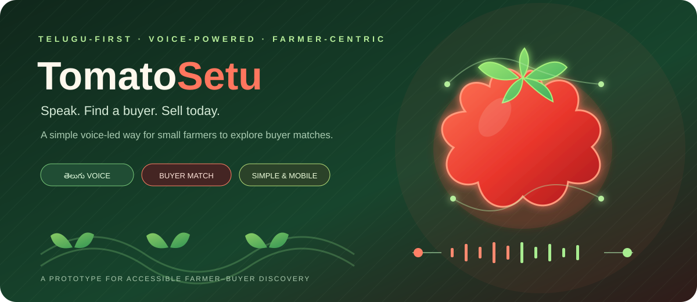
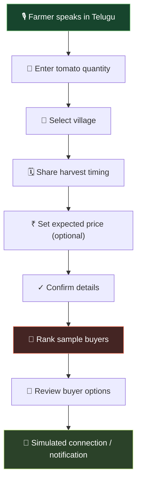

<div align="center">



# 🍅 TomatoSetu — టమాటో సేతు

### Speak. Find a buyer. Sell today.

**A Telugu-first voice-based tomato buyer-discovery prototype for small-scale farmers.**

[🌐 Live Demo](https://tomato-setu.netlify.app) · [📦 GitHub Repository](https://github.com/rohitbandi0311-afk/tomato-setu)


</div>

---

## 🌱 The problem

Small-scale tomato farmers can struggle to find a buyer quickly after harvesting. Because tomatoes are perishable, waiting for a buyer can mean lower prices or unsold produce. Language barriers and dependence on informal buyer networks can make the process harder.

## 💡 The idea

**TomatoSetu** explores a simple, voice-led way for farmers to describe what they want to sell and discover potential buyers.

The prototype is designed around a Telugu-first conversation, with English and manual text input as alternatives. A farmer can provide quantity, village, harvest timing and expected price, then review a short list of sample buyer matches.

## 🔄 How the prototype works



## ✨ Key features

| Feature | Description |
|---|---|
| **Telugu-first voice input** | Uses the browser Speech Recognition API with Telugu (India) locale where supported |
| **Spoken responses** | Uses browser Speech Synthesis when a Telugu voice is available |
| **Text fallback** | Farmers can type responses when voice input is unavailable or unclear |
| **Guided farmer flow** | Collects quantity, village, harvest timing and optional expected price |
| **Input confirmation** | Lets the farmer confirm or correct details before matching |
| **Buyer discovery** | Ranks the in-code sample buyers using quantity, distance and offered price |
| **Buyer cards** | Shows sample buyer location, distance, quantity requirement and price |
| **Buyer registration demo** | Allows a sample buyer to be added during the session |
| **Connection flow** | Demonstrates a buyer confirmation and pickup-time selection |
| **Mobile-first interface** | Compact chat-based experience designed for phone screens |

## 🧭 Matching logic

The current prototype uses a small buyer list stored directly in the application JavaScript. It filters for buyers marked as available today and with a quantity requirement that meets the prototype's threshold, estimates distance from the selected village using geographic coordinates, and ranks the remaining matches using a simple score based on quantity, offered price and distance.

This is a demonstration matching approach, not a production marketplace algorithm.

## 🛠️ Technology

| Layer | Technology |
|---|---|
| Interface | HTML5 |
| Styling | CSS3 |
| Application logic | Vanilla JavaScript |
| Speech input | Browser Speech Recognition API |
| Speech output | Browser Speech Synthesis API |
| Location/distance | Coordinates embedded in the sample data; Haversine distance calculation |
| Container | Docker, Docker Compose |
| Hosting | Netlify |

## 🚀 Try the live prototype

1. Open [TomatoSetu](https://tomato-setu.netlify.app) in a compatible browser.
2. Select **Try sample farmer** to run the guided demonstration.
3. Follow the Telugu conversation and view the buyer suggestions.
4. Explore the buyer list and sample buyer registration.
5. Try the manual text input if speech recognition is unavailable.

For the best voice experience, use a recent version of Google Chrome and allow microphone access. Telugu speech output depends on whether the device has a compatible Telugu voice installed.

## 💻 Run locally with Docker

### Prerequisites

- Docker Desktop
- Docker Compose

### 1. Clone the repository

```bash
git clone https://github.com/rohitbandi0311-afk/tomato-setu.git
cd tomato-setu
```

### 2. Build and start

```bash
docker compose up --build
```

### 3. Open the app

Visit [http://localhost:8080](http://localhost:8080).

### 4. Stop the container

```bash
docker compose down
```

The Docker image serves the static application through Nginx.

## 📁 Project structure

```text
tomato-setu/
├── docs/
│   └── assets/
│       └── tomatosetu-hero.svg
├── index.html
├── Dockerfile
├── docker-compose.yml
├── README.md
└── README (2).md
```

## ⚠️ Prototype scope & limitations

Please read these limitations before interpreting a match as a real market offer:

- Buyer names, locations, quantities, prices and availability are **sample data** embedded in the application.
- The buyer matching process is a demonstration; it does not connect to a verified live buyer database.
- Buyer registration adds an entry to the current browser session's in-memory application data; it is not a persistent account system.
- Buyer connection and notification messages are simulated. No real call, SMS, message or buyer request is sent.
- Browser speech recognition and speech synthesis depend on browser, network, microphone permission and device language support.
- The prototype currently focuses on tomato farmers around Kakinada and nearby locations in Andhra Pradesh.

## 🔭 Future improvements

- Verified farmer and buyer accounts
- Live market prices and buyer availability
- Persistent buyer listings and farmer profiles
- Direct farmer-to-buyer calling and messaging
- More Indian languages and regional dialect support
- SMS and phone-call notifications
- Field testing with farmers and local market participants

## 👨‍💻 Built by

**Rohith Bandi · Thedevodyssey**

[GitHub](https://github.com/rohitbandi0311-afk) · [TomatoSetu Repository](https://github.com/rohitbandi0311-afk/tomato-setu)

---

<div align="center">

### రైతుకు సులభమైన మాట — కొనుగోలుదారుని చేరే బాట

*Accessible voice technology for farmer–buyer discovery.*

</div>
